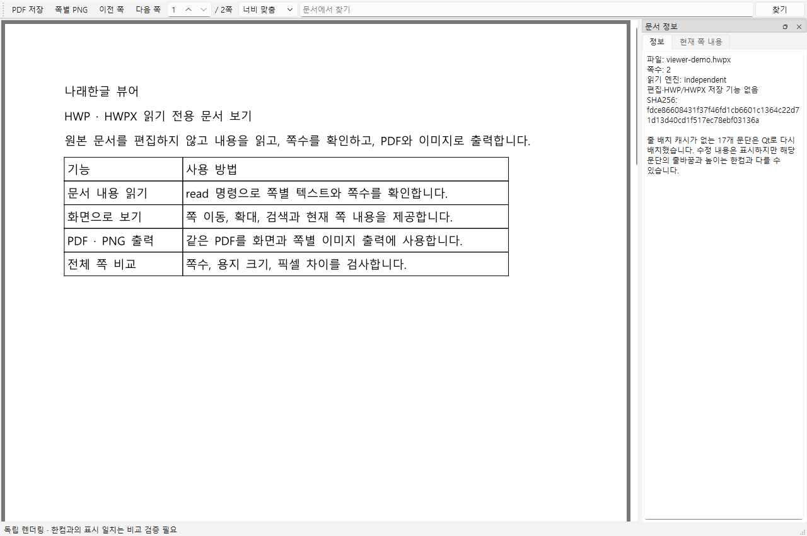

# 나래한글 뷰어

HWP/HWPX 읽기 전용 화면·CLI입니다. PDF와 쪽별 PNG로 출력하고 나래엔진의 결과를 한컴 기준 PDF와 전체 쪽 비교할 수 있습니다.

그림의 잘라내기·뒤집기·회색조·흑백 효과를 표시합니다. 밝기·대비·그림 개체 투명도 등 남은 제한은 검증 JSON의 `layout.image_limitations`에서 확인할 수 있습니다.



Windows에서는 `narae_viewer.pyw`를 더블클릭하면 문서 선택창이 열립니다. Python과 엔진 의존성이 필요합니다.

```powershell
python narae_viewer.py open "보고서.hwp"
python narae_viewer.py read "보고서.hwpx" --result read.json
python narae_viewer.py export "보고서.hwp" --pdf view.pdf --png-dir pages
python narae_viewer.py verify "보고서.hwpx" --hancom --result comparison.json
```

기본값은 독립 SourceLayout입니다. 한컴 자체 조판으로 확인할 때는 `--backend hancom`을 사용합니다. 독립 모드에는 표시 차이가 남으므로 **모든 문서의 쪽수·픽셀 일치가 완료된 버전은 아닙니다.**

[명령·설치·비교 결과 안내](../1_나래엔진/narae-hangul/references/viewer.md) · [AI 스킬](../2_나래스킬/narae-viewer/SKILL.md)
